  

  <strong>Train and run AI in your game.</strong>

  
  
  
  

## What is Neura?

Neura is an **AI framework designed for games**. It lets you **train and run models such as Qwen locally inside your game**, using the game's native graphics API—**no CUDA required**.

## Features

- **High Performance**: Designed for local devices with limited VRAM and compute.
- **Game-loop Integration**: Run training and inference directly from your frame loop, without async/await.
- **Cross-platform Deployment**: Neura runs wherever your game runs, using the same native graphics API.
- **Kernel Compiler**: Custom kernels written in Rust are compiled by Neura's built-in AOT compiler into SPIR-V, HLSL, and MSL.

## Documents

- **[Examples](examples)**: Runnable examples for learning Neura and exploring specific concepts.

## Integrations

- **[bevy-neura](https://github.com/formetaohy/bevy-neura)**: An official integration for building AI-native games in [Bevy](https://bevy.org).

## Contact

Email: formetaohy@gmail.com

## License

[MIT](LICENSE)
